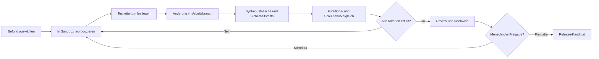

# Technischer Kundenbericht und Umsetzungsplan

Projekt: IBB Harz Website  
Stand: 27. Oktober 2026  
Status: Bestandsaufnahme abgeschlossen, keine Änderungen an Produktion

## 1. Ziel dieses Berichts

Dieser Bericht schafft eine verständliche Grundlage für die gemeinsame Festlegung des Arbeitspakets. Er beschreibt:

- den nachgewiesenen Ausgangszustand,
- die priorisierten technischen Handlungsfelder,
- den vorgeschlagenen Leistungsumfang,
- den sicheren Ablauf von der Sandbox bis zur Produktion,
- die benötigten Entscheidungen und Abnahmen.

Sicherheitsrelevante technische Einzelheiten werden in dieser öffentlichen Fassung absichtlich nicht veröffentlicht. Sie sind im privaten technischen Projektarchiv dokumentiert und können im geschützten Rahmen besprochen werden.

## 2. Management-Zusammenfassung

Die Website ist öffentlich erreichbar und funktional. Gleichzeitig besteht ein technisch gewachsener Stand mit veralteter Serverbasis, ausstehenden Aktualisierungen, individuellem WordPress-Code und mehreren Sicherheits-, Kompatibilitäts- und Qualitätsrisiken.

Ein direktes Aktualisieren auf der produktiven Website ist nicht vertretbar. Das Risiko von Funktionsausfällen, Darstellungsfehlern oder nicht vollständig rückgängig zu machenden Änderungen wäre zu hoch.

Empfohlen wird daher der folgende verbindliche Ablauf:

1. Aktuellen vollständigen Produktionsstand sichern.
2. Eine isolierte Sandbox aus diesem Stand aufbauen.
3. Befunde einzeln reproduzieren, beheben und testen.
4. Aktualisierungen schrittweise durchführen.
5. Funktionen und Darstellung gemeinsam abnehmen.
6. Erst danach einen freigegebenen Release kontrolliert produktiv setzen.
7. Produktion nach dem Rollout überwachen und bei Bedarf auf den gesicherten Ausgangsstand zurückgehen.

**Empfohlene erste Beauftragung:** Sandbox und Wiederherstellbarkeit, kritische Sicherheitskorrekturen, kontrollierte WordPress-/Plugin-/PHP-Migration sowie vollständige Regression und Kundenabnahme.

## 3. Nachgewiesener Umfang der Bestandsaufnahme

| Bereich | Ergebnis |
|---|---|
| Öffentliche Website | 104 über die Sitemap ermittelte URLs geprüft |
| Erreichbarkeit bei der Aufnahme | Alle 104 geprüften URLs antworteten mit HTTP 200 |
| Visuelle Referenz | 104 Desktop-Full-Page-Aufnahmen erstellt |
| Responsive Stichprobe | 10 zusätzliche Desktop- und Mobil-Aufnahmen wichtiger Seitentypen |
| WordPress-Dateibestand | Plugins, Themes und individuelle Erweiterungen ausschließlich lesend gesichert und untersucht |
| PHP-Syntaxprüfung | Mehrere Tausend PHP-Dateien automatisiert geprüft; keine Parse-Fehler im untersuchten Bestand |
| PHP-Kompatibilität | Statische Prüfsignale und mögliche Laufzeitrisiken je Komponente erfasst |
| Individueller Code | Child-Theme und kundenspezifische Erweiterungen zusätzlich manuell geprüft |
| Backup-Lage | Vorhandene Sicherung validiert; für den späteren Rollout ist dennoch ein frischer Vollsnapshot erforderlich |
| Produktivsystem | Keine Dateien, Inhalte, Einstellungen, Versionen oder Datenbankwerte verändert |

Die [vollständige Screenshot-Galerie](SCREENSHOT-GALERIE.md) dokumentiert den sichtbaren Ausgangsstand für spätere Vorher-/Nachher-Vergleiche.

## 4. Priorisierte Handlungsfelder

Die folgende Übersicht ist absichtlich kundenorientiert formuliert. Technische Angriffsdetails und interne Nachweise bleiben nicht öffentlich.

| ID | Priorität | Handlungsfeld | Geschäftliche Auswirkung | Empfohlene Maßnahme |
|---|---|---|---|---|
| K-01 | Kritisch | Sicherheitsrelevante Ein- und Ausgabeverarbeitung im individuellen Code | Risiko einer missbräuchlichen Darstellung oder Ausführung im Website-Kontext | In der Sandbox korrigieren und mit Negativtests absichern |
| K-02 | Hoch | Nicht mehr unterstützte Serverkomponenten | Erhöhtes Sicherheits- und Kompatibilitätsrisiko | Zielplattform definieren und die Migration stufenweise testen |
| K-03 | Hoch | Ausstehende Aktualisierungen von WordPress und aktiven Erweiterungen | Bekannte Fehler und Sicherheitslücken können bestehen bleiben | Updates einzeln oder in kleinen Gruppen mit Testgate durchführen |
| K-04 | Hoch | Kein ausreichend aktueller, vollständig getesteter Rückfallstand | Ein fehlerhafter Rollout könnte nur eingeschränkt zurückgesetzt werden | Frischen Vollsnapshot erzeugen und Restore in der Sandbox beweisen |
| K-05 | Hoch | Schutz privilegierter Benutzerkonten | Erhöhtes Risiko einer Kontoübernahme | Administratoren inventarisieren, Rechte minimieren und zweiten Faktor einführen |
| K-06 | Hoch | Dateiuploads benötigen zusätzliche Absicherung | Ungeeignete Dateien können ein Sicherheitsrisiko darstellen | Erlaubte Rollen und Dateitypen begrenzen, Inhalte sicher prüfen |
| K-07 | Mittel | Schwache mobile Ladeleistung | Schlechtere Nutzungserfahrung und mögliche Sichtbarkeitsnachteile | Bilder, Ressourcen, Cache und Ladeverhalten optimieren |
| K-08 | Mittel | Fehlende browserseitige Schutzmechanismen | Zusätzliche Sicherheitsschichten werden nicht genutzt | Sicherheitsheader zunächst in der Sandbox ergänzen und testen |
| K-09 | Mittel | Veraltete oder doppelte Frontend-Abhängigkeiten | Mehr Ladezeit und Risiko von JavaScript-Konflikten | Abhängigkeiten konsolidieren und Regressionstests durchführen |
| K-10 | Mittel | Barrierefreiheitsprobleme | Nutzungshürden und mögliches rechtliches Risiko | Kontrast, Beschriftungen, Fokusführung und Bedienziele korrigieren |
| K-11 | Mittel | SEO- und Informationsarchitektur | Inhalte können schlechter auffindbar oder uneindeutig indexierbar sein | Metadaten, Canonicals, Sitemap, Robots und Verlinkung prüfen |
| K-12 | Mittel | PHP-Risiken im individuellen Code | Nach einem PHP-Update können Warnungen oder Funktionsausfälle auftreten | Eingaben, Typen und Ausgaben härten; Laufzeittests unter Ziel-PHP durchführen |
| K-13 | Mittel | Datenbankwachstum und Aufbewahrung | Größere Backups, längere Wartung und unnötige Datenhaltung | Aufbewahrungsregeln abstimmen und erst nach Freigabe bereinigen |
| K-14 | Niedrig | Unvollständige Betriebsdokumentation | Erhöhte Abhängigkeit von Einzelwissen | Verantwortlichkeiten, Logs, Cron, Update- und Notfallweg dokumentieren |

## 5. Besondere Risiken bei PHP- und Plugin-Updates

Die statische Analyse zeigt, dass ein PHP-Update nicht als isolierter Schalter behandelt werden darf. Risiken entstehen vor allem in diesen Bereichen:

- Backup- und Wiederherstellungsfunktionen,
- Optimierung und Minifizierung,
- Sicherheits- und Login-Funktionen,
- Consent- und Datenschutzfunktionen,
- Page-Builder und zugehörige Pro-Komponenten,
- Formulare einschließlich Anhängen und Mailzustellung,
- individuelle Templates, Shortcodes und Paginierung,
- der kundenspezifische Info-Assistent.

Statische Prüftreffer sind noch kein Beweis für einen tatsächlichen Laufzeitfehler. Sie zeigen, welche Komponenten unter der künftigen PHP-Version gezielt ausgeführt und beobachtet werden müssen. Die verbindliche Bewertung erfolgt deshalb erst in der Sandbox durch reproduzierbare Funktions-, Negativ- und Logtests.

## 6. Vorgeschlagene Arbeitspakete

### AP 0 – Aktueller Snapshot und Sandbox

**Ziel:** Eine technisch isolierte und reproduzierbare Arbeitsumgebung schaffen.

- aktuellen Vollsnapshot einschließlich Datenbank, Uploads, WordPress, Plugins, Themes und Konfiguration erstellen,
- Sandbox auf einem getrennten, geschützten Ziel aufbauen,
- Suchmaschinenindexierung verhindern,
- produktiven Mailversand, Tracking, Webhooks und externe Integrationen blockieren oder auf Testziele umleiten,
- Fehlerlogging intern aktivieren, ohne Fehler öffentlich auszugeben,
- vollständigen Restore praktisch durchführen und dokumentieren.

**Abnahme:** Die Sandbox entspricht dem gesicherten Produktionsstand, ist von Produktion getrennt und aus dem Snapshot reproduzierbar wiederherstellbar.

### AP 1 – Kritische Sicherheitskorrekturen

**Ziel:** Die unmittelbarsten Angriffsflächen schließen.

- kritischen individuellen Codebefund beheben,
- Dateiupload absichern,
- privilegierte Konten und Rollen prüfen,
- zweiten Faktor für Administratoren vorbereiten,
- browserseitige Sicherheitsmechanismen in der Sandbox einführen.

**Abnahme:** Sicherheits- und Negativtests sind bestanden; legitime Funktionen bleiben unverändert.

### AP 2 – WordPress-, Plugin- und PHP-Migration

**Ziel:** Den veralteten Softwarestand kontrolliert auf eine unterstützte Plattform bringen.

- Erweiterungen unter der bisherigen PHP-Version in kleinen Gruppen aktualisieren,
- nach jeder Gruppe Funktions- und Screenshottests durchführen,
- WordPress Core separat aktualisieren,
- individuellen Code anpassen und erneut statisch prüfen,
- Zwischenziel und Zielversion von PHP getrennt testen,
- eine eventuelle Datenbankmigration separat planen und prüfen.

**Abnahme:** Keine ungeklärten kritischen oder hohen Fehler, keine neuen relevanten PHP-Fatals und vollständige Funktionsmatrix grün.

### AP 3 – Funktionale Regression und Kundenabnahme

**Ziel:** Fachliche Funktionen und Darstellung gemeinsam absichern.

- Kontakt- und Bewerbungsformulare einschließlich Anhängen und Mailzustellung,
- Editor, Templates und wiederverwendete Bausteine,
- Info-Assistent in allen eingesetzten Varianten,
- Consent-Banner und Datenschutzverhalten,
- Suche, News, Paginierung, Shortcodes und individuelle Felder,
- Login-Schutz und zweiter Faktor,
- Backup und Restore,
- visueller Vergleich gegen die 104 Referenzscreenshots.

**Abnahme:** Die benannten fachlichen Ansprechpartner bestätigen die Funktionsmatrix und akzeptieren dokumentierte visuelle Abweichungen.

### AP 4 – Performance, Frontend und Bilder

**Ziel:** Mobile Ladezeit und technische Stabilität verbessern.

- Bilder passend dimensionieren, komprimieren und in geeignete Formate überführen,
- Lazy Loading und kritische Ressourcen prüfen,
- doppelte Bibliotheken und unnötige Requests reduzieren,
- Cache und Minifizierung kontrolliert konfigurieren,
- Messung unter reproduzierbaren Bedingungen wiederholen.

**Abnahme:** Vereinbarte Zielwerte sind erreicht; keine funktionalen oder visuellen Regressionen.

### AP 5 – Barrierefreiheit, SEO und Inhaltstechnik

**Ziel:** Zugänglichkeit und Auffindbarkeit verbessern.

- Kontraste, Beschriftungen, Fokusführung, Touch-Ziele und ARIA korrigieren,
- Seitentitel, Metadaten, Canonicals, Sitemap, Robots und interne Verlinkung prüfen,
- priorisierte Seitentypen manuell mit Tastatur und Screenreader-Stichprobe testen.

**Abnahme:** Die vereinbarte Barrierefreiheits- und SEO-Prüfliste ist bestanden.

### AP 6 – Datenhaltung und Betriebsdokumentation

**Ziel:** Wartbarkeit und nachvollziehbaren Betrieb herstellen.

- Aufbewahrungsregeln für Revisionen, temporäre Daten und Protokolle abstimmen,
- erst nach Freigabe und aktuellem Backup bereinigen,
- Cron, Logs, Zuständigkeiten, Zugangseigentümer, Updateweg und Notfallablauf dokumentieren.

**Abnahme:** Regeln und Betriebsblatt sind freigegeben; Wiederherstellbarkeit bleibt nachgewiesen.

### AP 7 – Kontrolliertes Produktiv-Deployment

**Ziel:** Den abgenommenen Sandbox-Stand mit minimalem Risiko produktiv setzen.

- Deploymentumfang einfrieren und Release-Kandidat kennzeichnen,
- frischen Produktionssnapshot unmittelbar vor dem Rollout erzeugen,
- Wartungsfenster und Verantwortlichkeiten bestätigen,
- ausschließlich freigegebene Änderungen deployen,
- Cache kontrolliert leeren und Datenbankmigrationen nur einmal ausführen,
- Kernfunktionen, Logs und zentrale Seiten unmittelbar prüfen,
- bei nicht erfülltem Gate den dokumentierten Rückfallplan ausführen.

**Abnahme:** Produktion entspricht dem freigegebenen Release; Kernfunktionen und Nachkontrolle sind dokumentiert.

## 7. Kontrollierter Agent-Loop in der Sandbox

Der Agent-Loop ist ein dokumentierter Entwicklungszyklus. Automatisierte Unterstützung darf analysieren, reproduzieren, in einem getrennten Arbeitszweig ändern und Tests ausführen. Es gibt keinen unbeaufsichtigten direkten Produktionspfad.

Für jeden Loop werden mindestens dokumentiert:

- Ausgangsbefund und reproduzierbarer Testfall,
- betroffene Komponenten und Abhängigkeiten,
- Änderung und fachliche Begründung,
- automatisierte und manuelle Testergebnisse,
- Vorher-/Nachher-Vergleich oder Begründung, warum keine sichtbare Änderung entsteht,
- bekannte Restrisiken,
- Review- und Freigabestatus.

## 8. Freigabegates vor Produktion

Ein Produktiv-Deployment darf erst beginnen, wenn alle folgenden Punkte bestätigt sind:

- [ ] aktueller vollständiger Produktionssnapshot vorhanden,
- [ ] Restore in isolierter Umgebung erfolgreich bewiesen,
- [ ] Sandbox fachlich und technisch abgenommen,
- [ ] keine ungeklärten kritischen oder hohen Befunde im Releaseumfang,
- [ ] PHP- und WordPress-Logs ohne neue relevante Fehlerfolgen,
- [ ] Formulare, Mailversand, Info-Assistent, Consent, Login und Backup geprüft,
- [ ] visueller Vergleich gegen die Referenzscreenshots abgeschlossen,
- [ ] Deploymentanweisung und Rückfallplan dokumentiert,
- [ ] Wartungsfenster und verantwortliche Ansprechpartner bestätigt,
- [ ] Nachkontrolle und Beobachtungszeitraum vereinbart.

## 9. Entscheidungen und Mitwirkung des Kunden

Für die verbindliche Planung werden folgende Entscheidungen benötigt:

1. Welche Arbeitspakete werden beauftragt und in welcher Reihenfolge?
2. Wer nimmt Formulare, Inhalte, Darstellung, Info-Assistent und Datenschutz fachlich ab?
3. Welches Wartungsfenster ist für den Produktiv-Rollout zulässig?
4. Dürfen Test-E-Mails an definierte interne Empfänger versendet werden?
5. Welche Aufbewahrungsfristen gelten für Protokolle, Revisionen und weitere Daten?
6. Kann für die Umsetzung ein Hosting-Control-Panel- oder SSH-Zugang für Logs, PHP-Konfiguration, Cron und Snapshots bereitgestellt werden?
7. Welche messbaren Ziele gelten für Performance, Barrierefreiheit und SEO?

## 10. Klare Abgrenzung

Die bisherige Bestandsaufnahme hat die Website nicht verändert. Noch nicht durchgeführt wurden insbesondere:

- PHP-Wechsel,
- WordPress- oder Plugin-Updates,
- produktive Sicherheitskorrekturen,
- Datenbankbereinigung,
- produktiver Formularversand,
- Restore auf Produktion,
- automatisches oder manuelles Produktiv-Deployment.

Diese Tätigkeiten beginnen erst nach Beauftragung, Aufbau der Sandbox und Festlegung der Freigabekriterien.

## 11. Empfohlene nächste Entscheidung

Freigabe von AP 0 bis AP 3 als erste zusammenhängende Projektphase:

1. Wiederherstellbaren Ist-Stand sichern.
2. Sandbox aufbauen und Restore beweisen.
3. Kritische Befunde korrigieren.
4. WordPress, Plugins und PHP kontrolliert modernisieren.
5. Funktionen und Darstellung vollständig abnehmen.

Erst danach sollten Performance-, Barrierefreiheits-, SEO- und Datenbereinigungspakete umgesetzt und der freigegebene Gesamtstand produktiv ausgerollt werden.

---

[Zurück zur Übersicht](README.md) · [Screenshot-Galerie öffnen](SCREENSHOT-GALERIE.md)
